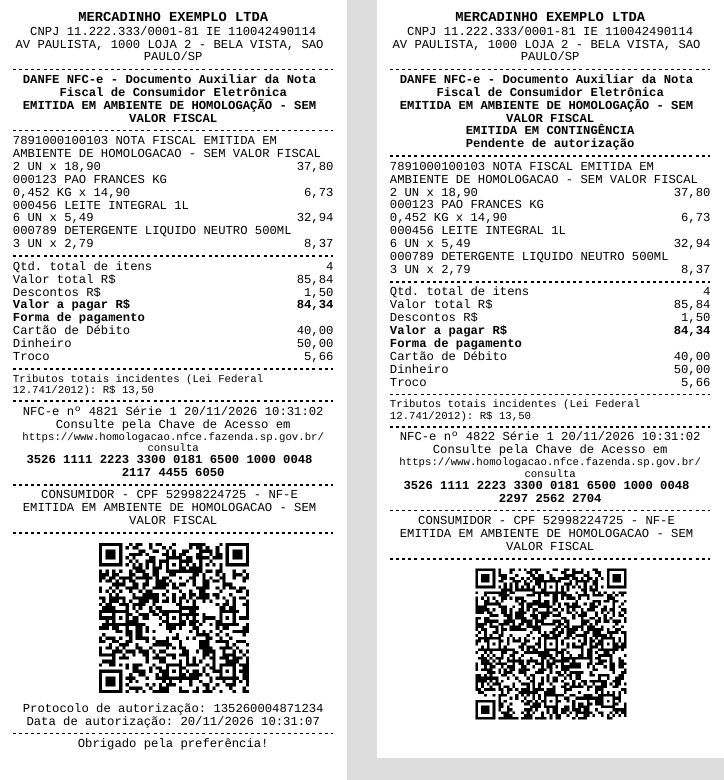

# @zexon/nfce

Biblioteca TypeScript/Node.js para operar a **NFC-e — Nota Fiscal de Consumidor Eletrônica (modelo 65, leiaute 4.00)** no dia a dia do varejo: emitir, consultar, cancelar, inutilizar, trabalhar em contingência offline e imprimir o DANFCE.

```ts
const r = await nfce.emitir(nota);
if (r.status === 'autorizada') await imprimir(await nfce.danfcePdf(r.xmlAutorizado!));
```

<p align="center"></p>

---

## Sumário

- [Situação do projeto](#situação-do-projeto)
- [Mudanças na v0.6](#mudanças-na-v06)
- [Mudanças na v0.5](#mudanças-na-v05)
- [Mudanças na v0.4](#mudanças-na-v04)
- [Recursos](#recursos)
- [Instalação](#instalação)
- [CLI e IAs (`nfce`, MCP, Skill)](#cli-e-ias-nfce-mcp-skill)
- [Primeiros passos](#primeiros-passos)
- [Montando a nota](#montando-a-nota)
- [Rotina diária (API)](#rotina-diária-api)
- [Reforma tributária (IBS/CBS)](#reforma-tributária-ibscbs)
- [Contingência offline](#contingência-offline)
- [DANFCE](#danfce)
- [Armazenamento dos XMLs](#armazenamento-dos-xmls)
- [Registro, numeração e resiliência](#registro-numeração-e-resiliência)
- [Configuração](#configuração)
- [URLs por UF (endpoints)](#urls-por-uf-endpoints)
- [Certificado e TLS](#certificado-e-tls)
- [Tratamento de erros](#tratamento-de-erros)
- [Checklist de homologação](#checklist-de-homologação)
- [Arquitetura](#arquitetura)
- [Desenvolvimento](#desenvolvimento)
- [Fontes oficiais](#fontes-oficiais)

---

## Situação do projeto

> **Versão 0.6 — pronta para homologação (Simples Nacional e Regime Normal com IBS/CBS), incluindo o Pará (SVRS).**
> Ainda não testada contra uma SEFAZ real; os testes usam uma SEFAZ simulada e os XSDs oficiais.

| Tema | Situação |
|---|---|
| Emissão, consulta, cancelamento, inutilização, status | ✅ Implementado |
| Contingência offline (`tpEmis=9`) e retransmissão | ✅ Implementado |
| CLI `nfce` para IAs, servidor MCP, Skill e JSON Schemas | ✅ Implementado (modo local: certificado na máquina) |
| EPEC da NFC-e (`tpEmis=4`, somente SP) | ✅ Implementado a partir da NT 2014.003 — validar na homologação de SP |
| Emissão resiliente: grava antes de enviar, retentativas, `retomar`, `processarPendentes` | ✅ Implementado |
| Registro das notas em banco e numeração automática (Postgres incluso) | ✅ Implementado (interfaces abertas para outros bancos) |
| QR Code v2 (com CSC) e v3 (sem CSC) | ✅ Implementado (v2 conferido com os exemplos do manual) |
| DANFCE em HTML e PDF (80 mm) | ✅ Implementado |
| XML validado contra os XSDs oficiais (ver [`schemas/README.md`](schemas/README.md)) | ✅ Coberto por testes |
| Cálculos fiscais em centavos inteiros (sem erro de ponto flutuante) | ✅ Implementado |
| **Reforma tributária (IBS/CBS)** — Simples Nacional / MEI (CRT 1, 2, 4) | ✅ Não exigido até 2027 (NT 2025.002) |
| **Reforma tributária (IBS/CBS)** — Regime Normal (CRT 3) | ✅ Grupo `IBSCBS` por item, redução de alíquota, `IBSCBSTot`, `vItem`, `vNFTot` (NT 2025.002 v1.53; tabela cClassTrib v1.71) |
| IBS/CBS: diferimento, crédito presumido, monofásico (combustíveis), compras governamentais | ❌ Fora do escopo (raros ou proibidos em NFC-e) |
| ICMS-ST (CST 10/30/70), IPI, ISSQN, Imposto Seletivo | ❌ Fora do escopo |
| URLs das 27 UFs (serviços, QR Code, consulta) | ✅ Tabela embutida (fonte: sped-nfe) — confira no nfce.encat.org antes de produção |

## Mudanças na v0.6

- **CLI `nfce`** (`npx @zexon/nfce ...`), feita para IAs e scripts: saída sempre em JSON, códigos de saída estáveis, erros por campo com sugestão, homologação por padrão e `--producao` obrigatório para emitir com valor fiscal. Ver [CLI e IAs](#cli-e-ias-nfce-mcp-skill).
- **Servidor MCP** (`nfce mcp`) com as mesmas operações, **Skill** (`skills/nfce`, instalável com `nfce skill instalar`) e **JSON Schemas** do arquivo da venda e do config (`schemas/cli/`).
- `FileRegistro` e `FileNumerador`: registro e numeração em arquivo, seguros para chamadas paralelas (usados pela CLI).
- `ValidationError.detalhes`: um `{ campo, mensagem }` por problema.
- Novas dependências: `ajv` e `@modelcontextprotocol/sdk`.

## Mudanças na v0.5

- **EPEC da NFC-e (somente SP).** `contingencia.emitirEpec(nota)` gera a NFC-e com `tpEmis=4`, registra o EPEC (evento 110140) no ambiente de contingência da SEFAZ-SP e devolve `protocoloEpec`; `processarPendentes` transmite depois a **mesma NFC-e**. Ver [EPEC (São Paulo)](#epec-são-paulo). Novos: `registrarEpec`, `protocoloEpec`, serviço `epecRecepcao`, tipo de storage `epec`, `RegistroNota.tpEmis` aceita 4. Quem implementou `Storage` próprio precisa aceitar o tipo `epec`.
- O DANFCE de uma NFC-e em EPEC traz a expressão exigida pela NT 2014.003, o protocolo, o motivo e a hora da contingência.

## Mudanças na v0.4

Correções a partir de uma revisão da v0.3. Atenção às mudanças de comportamento:

- **Contingência automática mais segura.** Só emite offline automaticamente quando é **certo** que a SEFAZ não recebeu a nota (conexão recusada, DNS, falha de TLS, SEFAZ 108/109) — e aí usa o **mesmo número**. Se o recebimento for incerto (timeout, conexão caída no meio), a nota fica `pendente` e o erro sai com `retentavel` e `chave`; nada de segunda nota automática. Para dar um cupom ao consumidor nesse caso, chame `contingencia.substituirPendente(chave, nota)` (número novo).
- **Todas as UFs**, incluindo **Pará**, BA, CE, MA e PE (antes faltavam), com URLs de QR Code e consulta.
- **Dinheiro em centavos inteiros**: soma de itens, ICMS, PIS/COFINS, IBS/CBS, `vNF` e troco sem erro de float.
- **Certificado x emitente**: notas de outra empresa (raiz de CNPJ diferente) são recusadas antes de assinar.
- **TLS ICP-Brasil**: `carregarCadeiaIcpBrasil()` + `transporte.casAdicionais`; erro de certificado vem com instrução.
- **Numeração**: um único número por nota viva (índice único no Postgres), inutilizações registradas, `buracos()` correto, `definirInicio` não volta a numeração, `reemitir` não reaproveita número ocupado.
- **Cancelamento** atualiza o registro (`cancelada`).
- **Prazo da contingência** sinalizado em `processarPendentes` (`prazo.situacao`: `ok` / `alerta` / `vencido`).
- **Interfaces**: `RegistroNotas` ganhou `buscarPorNumero` e `registrarInutilizacao`; erros ganharam `naoRecebido`. Quem implementou o próprio registro precisa adicionar os dois métodos. Rode `criarTabelas()` de novo (migração idempotente).

---

## Recursos

- **Cliente único** (`NfceClient`) com todas as operações da rotina de caixa.
- **Builder fluente** (`NfceBuilder`) que valida a nota e devolve **todos** os erros de uma vez.
- **Assinatura digital** XMLDSig (RSA-SHA1, C14N) com certificado A1 (`.pfx`).
- **Envio síncrono** com recuperação automática:
  - em timeout/queda, consulta a chave antes de decidir (não duplica nota já autorizada);
  - duplicidade (cStat 204) recupera o protocolo existente;
  - lote assíncrono (cStat 103/105) consulta o recibo.
- **Nenhuma nota perdida:** a nota é gravada antes do envio; falhas temporárias são repetidas e o que sobrar é concluído depois por `retomar`/`processarPendentes`, sempre com a mesma chave.
- **Idempotência por pedido:** `emitir(nota, { referencia: 'pedido-123' })` nunca gera duas notas para a mesma venda.
- **Registro em banco e numeração automática** por CNPJ/série/ambiente (Postgres pronto; outros bancos via interface).
- **Contingência offline** manual ou automática, com fila de retransmissão.
- **DANFCE** em HTML (para tela/impressão pelo navegador) e PDF (impressora térmica).
- **Armazenamento plugável** dos XMLs (disco, memória ou sua implementação).
- Textos obrigatórios de **homologação** aplicados automaticamente.
- Node ≥ 20, ESM + CommonJS, tipagem completa.

---

## Instalação

```bash
npm install @zexon/nfce
```

> Até a 0.4.0 o pacote se chamava `zexon-nfce` (não publicado no npm). A API é a mesma: basta trocar o import para `@zexon/nfce`.

Requisitos: Node.js 20+, certificado digital **A1** do emitente e **CSC** (se usar QR Code v2), obtido no portal da SEFAZ da sua UF.

---

## CLI e IAs (`nfce`, MCP, Skill)

A CLI emite **direto na SEFAZ** com o certificado A1 da máquina (modo local). Foi desenhada para agentes de IA: toda saída
é **um JSON** com `ok` e `proximoPasso`, e o **código de saída** diz o que fazer.

| Saída | Significado |
|---|---|
| 0 | ok |
| 1 | venda inválida — `erros[]` com `campo`, `mensagem` e `sugestao` |
| 2 | rejeitada pela SEFAZ — `cStat`, `xMotivo`, `dica` |
| 3 | temporário/pendente — a nota está gravada; rode `nfce pendentes --processar` depois (não emita outra) |
| 4 | configuração/certificado — rode `nfce doctor` |
| 5 | uso incorreto (ex.: produção sem `--producao`) |

```bash
npx @zexon/nfce init --uf SP --cnpj 11222333000181 --razao-social "MINHA LOJA LTDA" --ie 110042490114 --crt 1 \
  --certificado ./certificado.pfx --csc-id 1          # cria nfce.config.json (sem segredos)
export NFCE_CERT_SENHA=...  NFCE_CSC=...              # segredos só no ambiente
npx @zexon/nfce doctor                                # certificado, CSC, endpoints, SEFAZ
npx @zexon/nfce exemplo pix > venda-123.json          # modelo; o formato completo: nfce schema nota
npx @zexon/nfce validar venda-123.json                # sem rede, sem certificado
npx @zexon/nfce emitir venda-123.json --referencia 123   # mesma referência = mesma nota, nunca duas
npx @zexon/nfce pendentes --processar                 # agende: transmite contingência e pendentes
```

Outros comandos: `previa`, `contingencia offline|epec`, `consultar`, `status`, `cancelar`, `substituir`, `inutilizar`,
`buracos`, `reemitir`, `danfce`. Veja `nfce --help`.

- **Arquivo da venda:** só itens, pagamentos e consumidor (emitente, série e UF vêm do config). Schema em
  [`schemas/cli/nota.schema.json`](schemas/cli/nota.schema.json); config em [`schemas/cli/config.schema.json`](schemas/cli/config.schema.json).
- **Estado local** em `.nfce/` (XMLs, registro, numeração e DANFCE em PDF), com `.gitignore` próprio.
- **Segurança:** a senha do certificado e o CSC vêm de variáveis de ambiente (o config guarda só o *nome* da variável) e
  nunca aparecem na saída. Com `"ambiente": "producao"` no config, cada envio exige `--producao`.
- **MCP:** `npx @zexon/nfce mcp` (stdio) expõe `nfce_validar`, `nfce_previa`, `nfce_emitir`, `nfce_contingencia`,
  `nfce_pendentes`, `nfce_consultar`, `nfce_status`, `nfce_cancelar`, `nfce_danfce`, `nfce_doctor`, `nfce_schema` e
  `nfce_exemplo`. Exemplo de configuração de cliente MCP:
  ```json
  { "mcpServers": { "nfce": { "command": "npx", "args": ["-y", "@zexon/nfce", "mcp"], "env": { "NFCE_CONFIG": "/caminho/nfce.config.json" } } } }
  ```
  (as variáveis `NFCE_CERT_SENHA`/`NFCE_CSC` devem estar no ambiente do cliente MCP.)
- **Skill:** `npx @zexon/nfce skill instalar` copia [`skills/nfce`](skills/nfce/SKILL.md) para `.claude/skills/`,
  com o fluxo, as regras de segurança e referências (formato da venda, tributação, rejeições, contingência, cancelamento).

## Primeiros passos

```ts
import { readFileSync } from 'node:fs';
import { NfceClient, NfceBuilder, S3Storage } from '@zexon/nfce';

const nfce = new NfceClient({
  uf: 'SP',
  ambiente: 'homologacao',                       // 'producao' quando estiver pronto
  certificado: { pfx: readFileSync('certificado.pfx'), senha: process.env.CERT_SENHA! },
  csc: { id: 1, codigo: process.env.CSC! },      // sem csc => QR Code v3
  storage: new S3Storage({ bucket: 'minha-empresa-nfce' }),
  contingenciaAutomatica: true,
});

// 1) A SEFAZ está no ar?
console.log(await nfce.status()); // { online: true, cStat: '107', ... }

// 2) Monte a nota
const nota = new NfceBuilder()
  .emitente({
    cnpj: '11222333000181',
    razaoSocial: 'MERCADINHO EXEMPLO LTDA',
    inscricaoEstadual: '110042490114',
    regimeTributario: 1, // Simples Nacional
    endereco: {
      logradouro: 'AV PAULISTA', numero: '1000', bairro: 'BELA VISTA',
      codigoMunicipio: 3550308, municipio: 'SAO PAULO', uf: 'SP', cep: '01310100',
    },
  })
  .serie(1)
  .numero(4821)
  .cpfConsumidor('529.982.247-25')
  .item({
    codigo: '000123', descricao: 'CAFE TORRADO 500G', ncm: '09012100', cfop: '5102',
    unidade: 'UN', quantidade: 2, valorUnitario: 18.9,
    icms: { csosn: '102', origem: 0 },
  })
  .pagamento({ tipo: 'pix', valor: 37.8 })
  .build();

// 3) Emita
const r = await nfce.emitir(nota);

switch (r.status) {
  case 'autorizada':   console.log('Protocolo', r.protocolo); break;
  case 'contingencia': console.log('Emitida offline, será transmitida depois'); break;
  case 'rejeitada':
  case 'denegada':     console.error(r.cStat, r.xMotivo); break;
}
```

---

## Montando a nota

### Itens

| Campo | Obrigatório | Observação |
|---|---|---|
| `codigo`, `descricao` | sim | |
| `ncm` | sim | 8 dígitos |
| `cfop` | sim | 4 dígitos (ex.: `5102`, `5405`) |
| `unidade`, `quantidade`, `valorUnitario` | sim | até 4 casas decimais |
| `gtin` | não | validado pelo dígito verificador; omitido ⇒ `SEM GTIN` |
| `cest` | não | 7 dígitos |
| `desconto`, `frete`, `seguro`, `outrasDespesas` | não | por item |
| `icms` | sim | ver abaixo |
| `pis`, `cofins` | não | padrão: CST 49 com valores zerados |
| `valorTributosAprox` | não | Lei 12.741/2012, somado no total e impresso no DANFCE |
| `ibsCbs` | CRT 3 | `{ cClassTrib, aliquota*?, baseCalculo?, doacao? }` — ver [Reforma tributária](#reforma-tributária-ibscbs) |

### ICMS suportado

| Regime | Opções |
|---|---|
| Simples Nacional (`csosn`) | `101`, `102`, `103`, `300`, `400`, `500`, `900` |
| Regime Normal (`cst`) | `00`, `20`, `40`, `41`, `50`, `60`, `90` |

Quando a base e o valor não são informados, a biblioteca calcula a partir do valor do item (produto − desconto + despesas).

### Pagamentos

`tipo` aceita: `dinheiro`, `cheque`, `cartao_credito`, `cartao_debito`, `credito_loja`, `vale_alimentacao`, `vale_refeicao`, `vale_presente`, `vale_combustivel`, `boleto`, `deposito`, `pix`, `transferencia`, `programa_fidelidade`, `sem_pagamento`, `outros` — ou o código `tPag` de 2 dígitos.

- O troco (`vTroco`) é calculado automaticamente e só é aceito quando há pagamento em dinheiro.
- Cartão integrado ao TEF: informe `cartao: { integrado: true, cnpjCredenciadora, bandeira, autorizacao }`.

### Validações feitas antes do envio

CNPJ/CPF, GTIN, NCM, CFOP, CEST, município (IBGE), CEP, série (0–889), número, limite de 990 itens, CST/CSOSN compatível com o regime, desconto maior que o item, soma dos pagamentos × total da nota, endereço obrigatório na entrega em domicílio (`presenca(4)`).

---

## Rotina diária (API)

| Operação | Método | Retorno |
|---|---|---|
| Status da SEFAZ | `status()` | `{ online, cStat, xMotivo, tempoMedioSegundos }` |
| Emitir | `emitir(nota, { referencia? })` | `ResultadoEmissao` |
| Concluir nota pendente | `retomar(chave)` | `ResultadoEmissao` |
| Processar pendentes (cron/fila) | `processarPendentes({ limite?, cnpj? })` | `ResultadoEmissao[]` (nunca lança) |
| Reemitir rejeitada (mesmo número) | `reemitir(chave, notaCorrigida)` | `ResultadoEmissao` |
| Cupom offline para venda pendente incerta | `contingencia.substituirPendente(chave, nota)` | `ResultadoEmissao` (`status: 'contingencia'`, número novo) |
| Montar e assinar sem enviar | `preparar(nota, { offline? })` | `{ chave, xmlAssinado, qrCode, urlChave, totais }` |
| Consultar por chave | `consultar(chave)` | `{ situacao: 'autorizada' \| 'cancelada' \| 'denegada' \| 'inexistente' \| 'outra', protocolo, eventos }` |
| Cancelar | `cancelar({ chave, protocolo, justificativa })` | `ResultadoEvento` |
| Cancelar por substituição | `cancelarPorSubstituicao({ chave, protocolo, justificativa, chaveSubstituta })` | `ResultadoEvento` |
| Inutilizar numeração | `inutilizar({ serie, numeroInicial, numeroFinal?, justificativa })` | `ResultadoInutilizacao` |
| Emitir offline | `contingencia.emitirOffline(nota, motivo?, { referencia? })` | `ResultadoEmissao` (`status: 'contingencia'`) |
| Listar pendentes | `contingencia.pendentes()` | chaves |
| Retransmitir pendentes | `contingencia.transmitirPendentes()` | igual a `processarPendentes()` |
| DANFCE | `danfceHtml(xml)` / `danfcePdf(xml)` | `string` / `Buffer` |

### `ResultadoEmissao`

```ts
{
  status: 'autorizada' | 'rejeitada' | 'denegada' | 'contingencia'
        | 'pendente' | 'cancelada' | 'conflito';  // ver "Registro, numeração e resiliência"
  chave: string;              // 44 dígitos
  numero: number; serie: number;
  cStat: string; xMotivo: string;
  protocolo?: string; dataAutorizacao?: string;
  xmlAssinado: string;        // NFe assinada, com QR Code
  xmlAutorizado?: string;     // nfeProc (NFe + protocolo): guarde por 5 anos
  qrCode: string; urlChave: string;
  totais: { valorNota: number };
  tentativas?: number;        // tentativas de envio nesta chamada
}
```

### Exemplos

```ts
// Cancelar (justificativa de 15 a 255 caracteres)
await nfce.cancelar({ chave: r.chave, protocolo: r.protocolo!, justificativa: 'Desistencia da compra pelo cliente' });

// Inutilizar números pulados
await nfce.inutilizar({ serie: 1, numeroInicial: 4830, numeroFinal: 4835, justificativa: 'Falha no sistema pulou a numeracao' });

// Conferir uma nota
const c = await nfce.consultar('35261111222333000181650010000048211499370670');
```

---

## Reforma tributária (IBS/CBS)

Implementação conforme a **NT 2025.002-RTC v1.53** e a **tabela oficial de cClassTrib (IT 2025.002 v1.71)**, embutida na biblioteca com os 40 códigos permitidos em NFC-e.

**Quem precisa informar**

| Emitente | Obrigação |
|---|---|
| Regime Normal (CRT 3) | Obrigatório por lei desde 01/01/2026. Em homologação, a SEFAZ rejeita a nota sem o grupo (rejeição 1115) desde 01/07/2026; em produção a rejeição será ativada depois. A biblioteca **bloqueia o envio** se faltar. |
| Simples Nacional / MEI (CRT 1, 2, 4) | Só a partir de 2027 (NT futura). Hoje é opcional. |

**Uso**: informe só o `cClassTrib`; CST, alíquotas e valores são calculados.

```ts
// Em todos os itens que não informarem ibsCbs
new NfceClient({ /* ... */ ibsCbsPadrao: { cClassTrib: '000001' } }); // tributação integral

// Por item
.item({ /* ... */ ibsCbs: { cClassTrib: '200034' } })              // alimentos: redução de 60%
.item({ /* ... */ ibsCbs: { cClassTrib: '200003' } })              // cesta básica: redução de 100%
.item({ /* ... */ ibsCbs: { cClassTrib: '410999' } })              // não incidência
.item({ /* ... */ ibsCbs: { cClassTrib: '410003', doacao: true } }) // doação/amostra grátis
```

**O que a biblioteca calcula**

- **Base (UB16-10):** vProd + vFrete + vSeg + vOutro − vDesc − vPIS − vCOFINS − vICMS − vFCP (pode ser sobrescrita com `baseCalculo`).
- **Alíquotas padrão por ano de emissão:**

  | Ano | IBS UF | IBS Mun | CBS |
  |---|---|---|---|
  | 2026 | 0,1% | 0% | 0,9% |
  | 2027–2028 | 0,05% | 0,05% | informar (aguarda legislação) |

  Outros valores podem ser informados em `aliquotaIBSUF`, `aliquotaIBSMun` e `aliquotaCBS`.
- **Redução de alíquota (`gRed`):** percentual tirado da tabela do cClassTrib; alíquota efetiva com 4 casas (UB28/UB66).
- **Totais:** `IBSCBSTot`, `vItem` por item e `vNFTot`. Até 2026 o IBS/CBS **não** soma em `vItem`/`vNFTot`; a partir de 2027 soma (VB01-10).
- **Validações:** cClassTrib existente e permitido em NFC-e, vigência, indicador de doação, CSTs com grupos não suportados.
- **`cMunFGIBS`:** informado automaticamente quando `presenca(5)` (venda presencial fora do estabelecimento), usando `municipioFatoGerador` ou o município do emitente (regras B25b-60/70).

> O DANFCE ainda não exibe IBS/CBS: a NT informa que o novo leiaute do DANFE está "em estudo".

---

## Contingência offline

Quando a SEFAZ não responde, a NFC-e pode ser emitida offline (`tpEmis=9`) e transmitida depois. **Prazo:** a regra nacional é o fim do primeiro dia útil seguinte à emissão; algumas UFs (como o Pará) usam 24 h — confira a regra vigente. A biblioteca sinaliza o prazo, mas **agendar `processarPendentes` é obrigação de quem usa** (cron, fila, worker).

### EPEC (São Paulo)

Só a SEFAZ-SP oferece o **EPEC** (Evento Prévio de Emissão em Contingência) para NFC-e — NT 2014.003. Em SP a contingência offline (`tpEmis=9`) é permitida desde a Portaria SRE 40/2024; em **produção o EPEC só é ativado pela SEFAZ quando o ambiente normal de autorização está indisponível** (em homologação está sempre ativo). Fora dessas situações a SEFAZ rejeita o EPEC.

```ts
try {
  const r = await nfce.contingencia.emitirEpec(nota, 'Internet da loja fora do ar', { referencia: pedido.id });
  imprimir(await nfce.danfcePdf(r.xmlAssinado)); // com a expressão de EPEC e o protocolo (r.protocoloEpec)
} catch (e) {
  // EPEC rejeitado (ex.: 142 bloqueado): nada foi autorizado; o número e a referência foram liberados.
  // Use emitirOffline com o mesmo `numero` (e.chave aponta a tentativa rejeitada).
}
// agendado: transmite a MESMA NFC-e (mesma chave) e concilia o EPEC
await nfce.processarPendentes();
```

- A NFC-e do EPEC sai com `tpEmis=4`, `dhCont` e `xJust`; o EPEC repete IE, `dhEmi`, destinatário (se houver), `vNF` e `vICMS` — a SEFAZ rejeita divergência (467).
- **Prazo:** passado o prazo legal sem transmitir a NFC-e, a SEFAZ **bloqueia novos EPEC** do emitente (142). `processarPendentes` sinaliza o prazo como na contingência offline.
- Não existe cancelar o EPEC: se a venda for desfeita, autorize a NFC-e e cancele-a.
- Falha de rede ao registrar o EPEC deixa a nota em `contingencia`; `retomar`/`processarPendentes` refazem o EPEC antes de transmitir.
- **Conferir na homologação de SP:** o `cabeçalho nfeCabecMsg` (`versaoDados 1.00`), o namespace/SOAPAction do ASMX e o formato do QR Code do EPEC (usamos o online) foram montados a partir da NT e do sped-nfe, sem acesso ao WSDL (exige certificado).

### Três situações diferentes

| Situação | O que a biblioteca faz | O que você faz |
|---|---|---|
| SEFAZ **sabidamente fora** antes de tentar (ex.: `status()` deu 108) | — | `contingencia.emitirOffline(nota)` |
| Tentativa online falhou e é **certo** que a SEFAZ não recebeu (conexão recusada, DNS, TLS, 108/109) | com `contingenciaAutomatica`: emite offline com o **mesmo número**; a chave online vira `descartada` | imprimir o DANFCE de contingência |
| Tentativa online com recebimento **incerto** (timeout, conexão caída no meio) | **não** cria outra nota; fica `pendente` e lança erro `retentavel` com `chave` | esperar `processarPendentes` (até 5 min a mesma nota ainda pode ser autorizada) **ou** dar o cupom com `contingencia.substituirPendente(chave, nota)` |

Por que essa diferença: uma nota online cuja resposta se perdeu pode ter sido autorizada. Emitir outra com o mesmo número geraria rejeição 539; emitir outra e não acompanhar a primeira deixaria a venda com duas notas. Por isso a segunda nota só é automática quando não há dúvida.

```ts
const nfce = new NfceClient({ /* ... */ contingenciaAutomatica: true, storage, registro, numerador });

try {
  const r = await nfce.emitir(nota, { referencia: pedido.id });
  imprimir(r); // 'autorizada' ou 'contingencia'
} catch (e) {
  if (e instanceof NfceError && e.retentavel && e.chave) {
    // incerto: o consumidor está no caixa — emitir cupom de contingência com outro número
    const off = await nfce.contingencia.substituirPendente(e.chave, nota);
    imprimir(off);
  } else throw e;
}

// agendado (ex.: a cada 2 minutos)
for (const r of await nfce.processarPendentes()) {
  if (r.prazo?.situacao === 'vencido' || r.prazo?.situacao === 'alerta') alertar(r);
  if (r.status === 'conflito') alertar(r); // cancelar a nota original (ver abaixo)
}
```

Como `processarPendentes` resolve cada caso:

1. **Contingência (`tpEmis=9`)**: consulta e transmite. Prazo em `r.prazo` (`ok`, `alerta` após 18 h, `vencido` após 24 h — `prazoContingencia: { horas, alertaHoras }`); a transmissão é tentada mesmo vencida.
2. **Pendente online**: consulta; se a SEFAZ não conhece, reenvia o **mesmo XML**. Depois de 5 minutos do `dhEmi` a SEFAZ rejeita (704, regra B09-40) → `rejeitada`; use `reemitir(chave, nota)` (mesmo número).
3. **Substituída** (`substituirPendente`): **nunca** é reenviada, só consultada:
   - apareceu **autorizada** → `conflito`: a venda ficou com duas notas; **cancele a original** (`cancelar`) dentro do prazo da UF;
   - SEFAZ não conhece e já passou a janela de 5 min (+5 de margem) → `descartada`: o número aparece em `buracos()` para inutilizar.

O DANFCE de contingência sai com "EMITIDA EM CONTINGÊNCIA — Pendente de autorização". As notas online abandonadas ficam guardadas em `storage` (`substituidas/`).

---

## DANFCE

```ts
const pdf  = await nfce.danfcePdf(r.xmlAutorizado!, { rodape: 'Obrigado pela preferência!' });
const html = await nfce.danfceHtml(r.xmlAutorizado!);          // inclui QR Code embutido
```

- Aceita o `nfeProc` (autorizada) ou a NFe assinada (contingência).
- Largura padrão 80 mm (`larguraMm` para 58 mm); a altura do PDF acompanha o conteúdo.
- As funções também existem soltas: `gerarDanfcePdf(xml)`, `gerarDanfceHtml(xml)`.

---

## Armazenamento dos XMLs

`storage` recebe qualquer objeto que implemente a interface `Storage`. A biblioteca traz três prontos:

| Classe | Uso |
|---|---|
| `S3Storage` | Amazon S3 ou compatível — produção, vários caixas/lojas compartilhando a fila de contingência |
| `FileStorage` | pasta local — um único servidor/PDV |
| `MemoryStorage` | testes |

```ts
import { S3Storage, FileStorage } from '@zexon/nfce';

new NfceClient({ /* ... */ storage: new S3Storage({ bucket: 'minha-empresa-nfce' }) });
new NfceClient({ /* ... */ storage: new FileStorage('./nfce-data') });
```

### S3Storage

```bash
npm install @aws-sdk/client-s3   # dependência opcional, só para quem usa S3
```

```ts
new S3Storage({ bucket: 'minha-empresa-nfce' });          // mínimo necessário

new S3Storage({
  bucket: 'minha-empresa-nfce',
  prefixo: 'loja-01',                                     // padrão: 'nfce'
  regiao: 'sa-east-1',                                    // padrão: AWS_REGION
  credenciais: { accessKeyId, secretAccessKey },          // padrão: cadeia da AWS (env, perfil, IAM role)
});

// MinIO, Cloudflare R2, DigitalOcean Spaces, Wasabi...
new S3Storage({ bucket: 'nfce', endpoint: 'https://<conta>.r2.cloudflarestorage.com', criptografia: false });
```

- Credenciais: se não informadas, valem as variáveis `AWS_ACCESS_KEY_ID`/`AWS_SECRET_ACCESS_KEY`, o perfil `~/.aws` ou a IAM role da máquina/container.
- Chaves no bucket: `<prefixo>/<tipo>/<chave>.xml` — ex.: `loja-01/autorizadas/3526…0670.xml`.
- Objetos gravados com `Content-Type: application/xml` e criptografia `AES256` no servidor.
- Permissões IAM mínimas: `s3:PutObject`, `s3:GetObject`, `s3:DeleteObject` e `s3:ListBucket` no bucket.
- Dica: ative o **versionamento** do bucket e uma regra de ciclo de vida para manter os XMLs pelo prazo legal (5 anos).

### Implementação própria

Para banco de dados ou outro serviço, implemente a interface. Tipos de documento: `autorizadas`, `pendentes`, `contingencia`, `rejeitadas`, `substituidas`, `cancelamentos`, `inutilizacoes`.

```ts
interface Storage {
  salvar(tipo, nome, conteudo): Promise<void>;
  ler(tipo, nome): Promise<string | undefined>;
  listar(tipo): Promise<string[]>;
  remover(tipo, nome): Promise<void>;
}
```

---

## Registro, numeração e resiliência

A biblioteca não tem fila nem banco próprios. Ela garante que cada operação possa ser **repetida com segurança** e deixa o estado gravado onde o seu sistema consegue retomar. *Quando* processar (cron, fila, worker) fica com você.

Três peças independentes e opcionais, cada uma uma interface:

| Peça | Função | Prontas |
|---|---|---|
| `storage` (`Storage`) | XML assinado/autorizado (imutável) | `S3Storage`, `FileStorage`, `MemoryStorage` |
| `registro` (`RegistroNotas`) | estado e dados de cada nota (banco) | `PostgresRegistro`, `MemoryRegistro` |
| `numerador` (`Numerador`) | próximo número por CNPJ/série/ambiente | `PostgresNumerador`, `MemoryNumerador` |

### Configuração com Postgres

```ts
import { Pool } from 'pg';
import { NfceClient, S3Storage, PostgresRegistro, PostgresNumerador, criarTabelas } from '@zexon/nfce';

const pool = new Pool({ connectionString: process.env.DATABASE_URL });
await criarTabelas(pool);               // idempotente; ou use sqlMigracao() na sua ferramenta de migração

const nfce = new NfceClient({
  // ...uf, ambiente, certificado, csc
  storage: new S3Storage({ bucket: 'minha-empresa-nfce' }),
  registro: new PostgresRegistro(pool),
  numerador: new PostgresNumerador(pool),
});

// Sem `numero`: o numerador fornece. Com `referencia`: nunca duas notas para o mesmo pedido.
const r = await nfce.emitir(notaSemNumero, { referencia: `pedido-${pedido.id}` });
```

Os adaptadores Postgres **não dependem de nenhum pacote**: recebem qualquer objeto com `query(sql, params)` — `pg.Pool`, `pg.Client`, uma transação (`PoolClient`) ou PGlite. Opção `{ schema: 'fiscal' }` para usar outro schema.

Tabelas criadas: `nfce_sequencia` (uma linha por CNPJ + ambiente + modelo + série), `nfce_nota` (uma linha por chave; `referencia` única por CNPJ/ambiente; **um único número por nota viva** — rejeitadas e descartadas não ocupam o número) e `nfce_inutilizacao` (faixas inutilizadas). `criarTabelas` é idempotente e também atualiza bancos criados na v0.3.

### O que acontece em `emitir`

1. Se a `referencia` já existe no registro → devolve (ou conclui) **a mesma nota**.
2. Valida a nota e, se não houver `numero`, pede ao `numerador` (só depois de validar: erro de validação não gasta número).
3. Assina e **grava antes de enviar**: XML em `storage` (`pendentes/`) e registro com `situacao: 'pendente'`. A chave fica fixada.
4. Envia com **retentativa curta** em falha temporária (padrão: 3 tentativas; `retentativas: { tentativas, esperasMs }`).
5. Se ainda falhar, **consulta a chave** (a SEFAZ pode ter autorizado sem a resposta chegar). Se não, a nota fica `pendente` e o erro sai com `retentavel: true` e `chave` — ou vai para contingência com o mesmo número, se `contingenciaAutomatica` e for **certo** que a SEFAZ não recebeu (ver [Contingência offline](#contingência-offline)).
6. Resultado definitivo → registro atualizado (`autorizada`, `rejeitada`, `denegada`, protocolo, tentativas) e XML movido.

### Concluindo o que ficou pendente

```ts
// Uma nota específica (ex.: o erro de emitir trouxe e.chave)
await nfce.retomar(chave);

// Todas: chame periodicamente — nunca lança, devolve o status de cada nota
await nfce.processarPendentes({ limite: 50 });
```

`retomar` é idempotente: consulta a chave antes e só reenvia o **mesmo XML** se a SEFAZ não a conhecer. Exemplos de agendamento:

```ts
setInterval(() => nfce.processarPendentes(), 60_000);                     // processo único
cron.schedule('*/2 * * * *', () => nfce.processarPendentes());             // node-cron
new Worker('nfce', async (job) => nfce.retomar(job.data.chave));           // BullMQ: enfileire e.chave
export const handler = async (ev) => { for (const m of ev.Records) await nfce.retomar(JSON.parse(m.body).chave); }; // SQS + Lambda
```

Em SaaS com vários emitentes, crie um `NfceClient` por empresa (o certificado é por empresa) compartilhando `storage`, `registro` e `numerador`, e passe `processarPendentes({ cnpj })` — o filtro por UF e ambiente é automático.

### Rejeições e numeração sem buracos

```ts
const r = await nfce.emitir(nota, { referencia: 'pedido-42' });
if (r.status === 'rejeitada') {
  // corrija e reemita com a MESMA série e número (nova chave; a referência passa para a nova nota)
  await nfce.reemitir(r.chave, notaCorrigida);
}

// Números entregues sem nota que os ocupe (requisições repetidas, falhas antes do envio, notas descartadas)
const buracos = await new PostgresRegistro(pool).buracos({ cnpj, ambiente: 'producao', serie: 1 });
for (const n of buracos) {
  await nfce.inutilizar({ serie: 1, numeroInicial: n, justificativa: 'Numero reservado e nao utilizado' });
} // inutilizações bem-sucedidas são registradas e deixam de aparecer em buracos()
```

`reemitir` recusa o número se outra nota viva já o ocupa (por exemplo, numa segunda reemissão da mesma chave rejeitada).

`PostgresNumerador.definirInicio(seq, 5001)` faz a numeração continuar de onde o emissor anterior parou. Ele **recusa voltar** a numeração (número ≤ último entregue), salvo `{ forcar: true }` — perigoso: só use se tiver certeza de que os números não foram usados.

**Cancelamento:** `cancelar` e `cancelarPorSubstituicao` atualizam o registro para `cancelada` (com `protocoloCancelamento` e `canceladaEm`); repetir `emitir` com a mesma `referencia` devolve `status: 'cancelada'`. O prazo de cancelamento é definido por cada UF (em várias é curto); a biblioteca não o controla — a SEFAZ rejeita fora do prazo.

### Situações no registro

| `situacao` | Significado |
|---|---|
| `pendente` | gravada, sem resposta definitiva — `processarPendentes` conclui |
| `contingencia` | emitida offline, aguardando transmissão |
| `autorizada` / `rejeitada` / `denegada` / `cancelada` | resposta definitiva da SEFAZ |
| `substituida` | nota online incerta trocada por contingência com outro número (só consultada, nunca reenviada) |
| `descartada` | a SEFAZ certamente não tem a nota; número livre (reaproveitado ou em `buracos`) |
| `conflito` | nota substituída que acabou autorizada — cancele-a |

### Outro banco

Implemente `RegistroNotas` (`registrar`, `atualizar`, `buscar`, `buscarPorReferencia`, `buscarPorNumero`, `pendentes`, `registrarInutilizacao`) e/ou `Numerador` (`proximo`). Requisitos: `registrar`/`atualizar` devem recusar com `RegistroDuplicadoError` chave ou referência repetida e duas notas vivas no mesmo número (situações fora de `SITUACOES_SEM_NUMERO`); `pendentes` devolve `pendente`, `contingencia` e `substituida`; `proximo` deve ser atômico. O `MemoryRegistro` é uma referência simples dessas regras.

---

## Configuração

| Opção | Tipo | Descrição |
|---|---|---|
| `uf` | `string` | UF do emitente (`'SP'`, `'MG'`...) |
| `ambiente` | `'homologacao' \| 'producao'` | |
| `certificado` | `{ pfx: Buffer \| string, senha }` | A1; `pfx` aceita o conteúdo ou o caminho |
| `csc` | `{ id, codigo }` | obrigatório para QR Code v2 |
| `qrCodeVersao` | `2 \| 3` | padrão: 2 com CSC, 3 sem |
| `storage` | `Storage` | `new S3Storage({ bucket })`, `new FileStorage(pasta)`, `new MemoryStorage()` ou implementação própria; obrigatório para contingência |
| `contingenciaAutomatica` | `boolean` | SEFAZ fora ⇒ emite offline |
| `endpoints` | `EndpointsOverride` | URLs de serviços, QR Code e consulta |
| `transporte` | `{ timeoutMs, casAdicionais, ca, rejectUnauthorized, fetchImpl }` | rede/TLS; `casAdicionais` = cadeia ICP-Brasil; `fetchImpl` para mocks |
| `responsavelTecnico` | `{ cnpj, contato, email, fone, csrt? }` | grupo `infRespTec` (+ hash CSRT) |
| `versaoSoftware` | `string` | vai em `verProc` |
| `fusoMinutos` | `number` | padrão pelo fuso da UF (ex.: −180, AM −240, AC −300) |
| `ibsCbsPadrao` | `{ cClassTrib, ... }` | IBS/CBS aplicado aos itens sem `ibsCbs` |
| `registro` | `RegistroNotas` | estado das notas em banco (`PostgresRegistro`); exige `storage` |
| `numerador` | `Numerador` | fornece `numero` quando a nota não traz (`PostgresNumerador`) |
| `retentativas` | `{ tentativas?, esperasMs? }` | padrão 3 tentativas, esperas 500/1500 ms |
| `prazoContingencia` | `{ horas?, alertaHoras? }` | padrão 24 h / alerta em 18 h |
| `relogio` | `() => Date` | relógio (testes) |

---

## URLs por UF (endpoints)

A biblioteca traz a tabela das **27 UFs** (serviços, URL do QR Code e URL de consulta por chave) gerada por `scripts/gerar-endpoints.mjs` a partir das tabelas mantidas pelo projeto [sped-nfe](https://github.com/nfephp-org/sped-nfe). A data da geração fica em `ENDPOINTS_GERADOS_EM`.

| Autorizador | UFs |
|---|---|
| **SVRS** (SEFAZ Virtual do RS) | AC, AL, AP, BA, CE, DF, ES, MA, **PA**, PB, PE, PI, RJ, RN, RO, RR, SC, SE, TO |
| Próprio | AM, GO, MG, MS, MT, PR, RS, SP |

**Pará:**

| | Homologação | Produção |
|---|---|---|
| Webservices (SVRS) | `https://nfce-homologacao.svrs.rs.gov.br/ws/...` | `https://nfce.svrs.rs.gov.br/ws/...` |
| QR Code | `https://appnfc.sefa.pa.gov.br/portal-homologacao/view/consultas/nfce/nfceForm.seam` | `https://appnfc.sefa.pa.gov.br/portal/view/consultas/nfce/nfceForm.seam` |
| Consulta por chave (`urlChave`) | `www.sefa.pa.gov.br/nfce/consulta` | `www.sefa.pa.gov.br/nfce/consulta` |

> ⚠️ As URLs mudam com o tempo. **Confira as da sua UF no Portal Nacional da NFC-e** (nfce.encat.org → Desenvolvedor → URL por UF do QR Code) e no portal do autorizador (SVRS: dfe-portal.svrs.rs.gov.br/Nfce/Servicos) antes de entrar em produção. Para atualizar a tabela: `node scripts/gerar-endpoints.mjs`.

Para corrigir uma UF sem esperar nova versão:

```ts
new NfceClient({
  // ...
  endpoints: {
    PA: {
      producao: { qrCode: 'https://<url-do-qrcode>', urlChave: 'www.sefa.pa.gov.br/nfce/consulta' },
    },
  },
});
```

Serviços: `autorizacao`, `retAutorizacao`, `consultaProtocolo`, `statusServico`, `inutilizacao`, `recepcaoEvento`. A `urlChave` precisa ter de 21 a 85 caracteres (XSD).

---

## Certificado e TLS

### Certificado do emitente (A1)

- Use um certificado **A1** (`.pfx`/`.p12`). O CNPJ é lido do certificado quando possível (usado na inutilização).
- O cliente recusa certificado vencido.
- **Conferência com o emitente:** se o CN do certificado traz o CNPJ, a biblioteca recusa (com `CertificateError`, antes de assinar) notas e inutilizações de empresa com **raiz de CNPJ** diferente — a mesma regra da SEFAZ (rejeição 213), que permite o certificado da matriz assinar para as filiais. Se o certificado não traz CNPJ no CN (ou é e-CPF), a conferência fica a cargo de quem chama.

### Cadeia ICP-Brasil (conexão com a SEFAZ)

Os servidores da SEFAZ usam certificados da cadeia **ICP-Brasil**, que **não** vem no Node. Sem ela, a primeira chamada real falha com:

```
TransportError: Não foi possível validar o certificado TLS de nfce-homologacao.svrs.rs.gov.br (UNABLE_TO_GET_ISSUER_CERT_LOCALLY)...
```

Passo a passo:

1. Baixe o pacote de certificados das ACs do repositório do ITI (Instituto Nacional de Tecnologia da Informação): página "Repositório" da ICP-Brasil em gov.br/iti — arquivo com todas as ACs (ex.: `ACcompactado.zip`).
2. Descompacte numa pasta do servidor (ex.: `./certs/icp-brasil`). Arquivos `.crt`, `.cer` ou `.pem`, em PEM ou DER, são aceitos.
3. Informe a cadeia:

```ts
import { carregarCadeiaIcpBrasil } from '@zexon/nfce';

new NfceClient({
  // ...
  transporte: { casAdicionais: carregarCadeiaIcpBrasil(process.env.SEFAZ_CA_DIR ?? './certs/icp-brasil') },
});
```

`casAdicionais` **soma** a cadeia aos certificados confiáveis do Node (alguns autorizadores usam certificados comerciais). A opção `ca` substitui todos — só use se souber o que faz. A cadeia não vem embutida no pacote para não ficar desatualizada; atualize a pasta quando o ITI publicar novas ACs. **Não** use `rejectUnauthorized: false`, nem em homologação.

---

## Tratamento de erros

| Classe | Quando |
|---|---|
| `ValidationError` | nota inválida antes do envio (`campos` lista os caminhos com problema) |
| `TransportError` | timeout, DNS, HTTP — `retentavel: true`; falha de certificado TLS — `retentavel: false` (configuração) |
| `SefazError` | SEFAZ indisponível (cStat 108/109/999) — `retentavel: true` |
| `RegistroDuplicadoError` | chave ou referência já registrada |
| `CertificateError` | PFX inválido, senha errada, certificado vencido |
| `NfceError` | base de todas; também endpoint/storage ausente |

Rejeições de negócio **não** lançam exceção: voltam em `status: 'rejeitada'` com `cStat` e `xMotivo`.

Todo `NfceError` tem `retentavel` (vale repetir mais tarde?), `naoRecebido` (é **certo** que a SEFAZ não recebeu?) e, quando a nota já foi gravada, `chave` — use-a em `retomar(chave)`, na sua fila ou em `contingencia.substituirPendente`.

```ts
try {
  const r = await nfce.emitir(nota);
} catch (e) {
  if (e instanceof ValidationError) mostrarErros(e.campos);
  else if (e instanceof NfceError && e.retentavel) await fila.enfileirar({ chave: e.chave }); // concluir depois com nfce.retomar
  else throw e;
}
```

---

## Checklist de homologação

1. Configurar a cadeia ICP-Brasil (`casAdicionais`) e solicitar o CSC de homologação no portal da SEFAZ.
2. `status()` deve retornar `cStat 107`.
3. Emitir notas com cada meio de pagamento que a loja usa (dinheiro com troco, cartão, PIX).
4. Emitir com e sem CPF do consumidor.
5. Cancelar uma nota (dentro do prazo da UF).
6. Inutilizar uma faixa.
7. **SP:** com `emitirEpec`, conferir o registro do EPEC (cStat 136), a transmissão da mesma chave e o DANFCE com a expressão de EPEC.
8. Simular queda de rede, emitir offline e retransmitir; testar `substituirPendente` e conferir a resolução por `processarPendentes`.
9. Derrubar o processo durante um envio e conferir que `processarPendentes()` conclui a mesma chave.
10. Ler o QR Code impresso com o celular e conferir a consulta pública.
11. Imprimir o DANFCE na impressora térmica real.

---

## Arquitetura

```
src/
  client/NfceClient.ts   fachada: emitir, consultar, cancelar, inutilizar, status, contingência
  builder/               NfceBuilder (API fluente)
  validation/            regras de negócio pré-envio
  xml/                   chave de acesso, montagem do infNFe, assinatura
  qrcode/                QR Code v2/v3 online e offline
  rtc/                   IBS/CBS: cálculo e tabela oficial de cClassTrib/CST
  sefaz/                 endpoints das 27 UFs (endpoints-dados.ts gerado), SOAP 1.2, parse de retornos
  events/                cancelamento, substituição, inutilização
  danfce/                HTML e PDF
  storage/               S3Storage, FileStorage, MemoryStorage
  registro/              interface RegistroNotas + MemoryRegistro
  numerador/             interface Numerador + MemoryNumerador
  postgres/              PostgresRegistro, PostgresNumerador, criarTabelas (sem dependências)
  errors/                hierarquia de erros (retentavel, naoRecebido)
  util/dinheiro.ts       aritmética fiscal em centavos inteiros
scripts/                 gerar-endpoints.mjs (atualiza a tabela de URLs)
schemas/                 XSDs oficiais (origem em schemas/README.md)
test/                    unitários, XSD, SEFAZ simulada, Postgres (PGlite) e cenários de falha
examples/                exemplo de ponta a ponta
```

---

## Desenvolvimento

```bash
npm install
npm test            # testes (a validação XSD usa o xmllint: apt install libxml2-utils)
npm run typecheck
npm run build       # dist/ ESM + CJS + .d.ts
```

### Publicar uma nova versão

```bash
npm version patch --no-git-tag-version   # ou minor/major
git commit -am "release: vX.Y.Z" && git push   # o workflow "Release" testa, compila, publica e cria a tag
```

O workflow roda a cada push na `main` que altere o `package.json`; se a versão já estiver no npm, ele não faz nada. O workflow `.github/workflows/release.yml` usa o secret `NPM_TOKEN` do repositório (token granular do npm com escrita em `@zexon`) e publica com *provenance*. `prepublishOnly` roda typecheck, testes e build, então uma versão quebrada não sai.

Exemplo de API para o Pará em homologação: `examples/emitir.ts` (lê `CERT_PFX`, `CERT_SENHA`, `CSC_ID`, `CSC`, `EMIT_CNPJ`, `EMIT_IE`, `DATABASE_URL`, `S3_BUCKET` e `SEFAZ_CA_DIR` do ambiente; requer `npm install pg`).

---

## Fontes oficiais

Portal Nacional da NF-e (nfe.fazenda.gov.br):

- Manual de Orientação ao Contribuinte (MOC) 7.0 e Anexo I — leiaute e regras de validação
- Manual de Especificações Técnicas do DANFE NFC-e e QR Code, versão 6.0
- Manual de Especificações da Contingência Offline para NFC-e, versão 2.0
- NT 2025.002 v1.53 — Reforma Tributária (IBS/CBS/IS)
- Tabela de Classificação Tributária do IBS e CBS (IT 2025.002 v1.71) e Tabela de Alíquotas da CBS
- Esquemas XML: ver [`schemas/README.md`](schemas/README.md)
- Tabelas de URLs por UF: projeto nfephp-org/sped-nfe (conferir no nfce.encat.org)

## Licença

Copyright (C) 2026 Lenderson Macedo.

**Licenciamento duplo** — escolha uma:

- **[AGPL-3.0](LICENSE)**: uso livre, inclusive comercial, desde que a aplicação que usa a biblioteca (inclusive acessada pela rede: PDV, ERP, API, SaaS) também tenha o código-fonte disponibilizado aos usuários sob a AGPL-3.0.
- **Licença comercial**: para usar em software fechado, sem as obrigações da AGPL. Veja [COPYRIGHT.md](COPYRIGHT.md).

Versões anteriores ao commit `13ee9c4` foram publicadas sob MIT.
